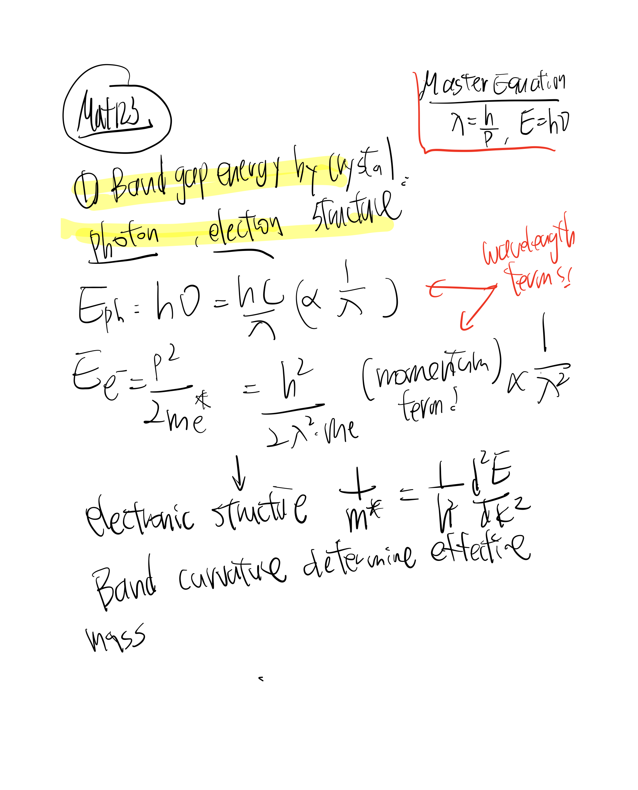
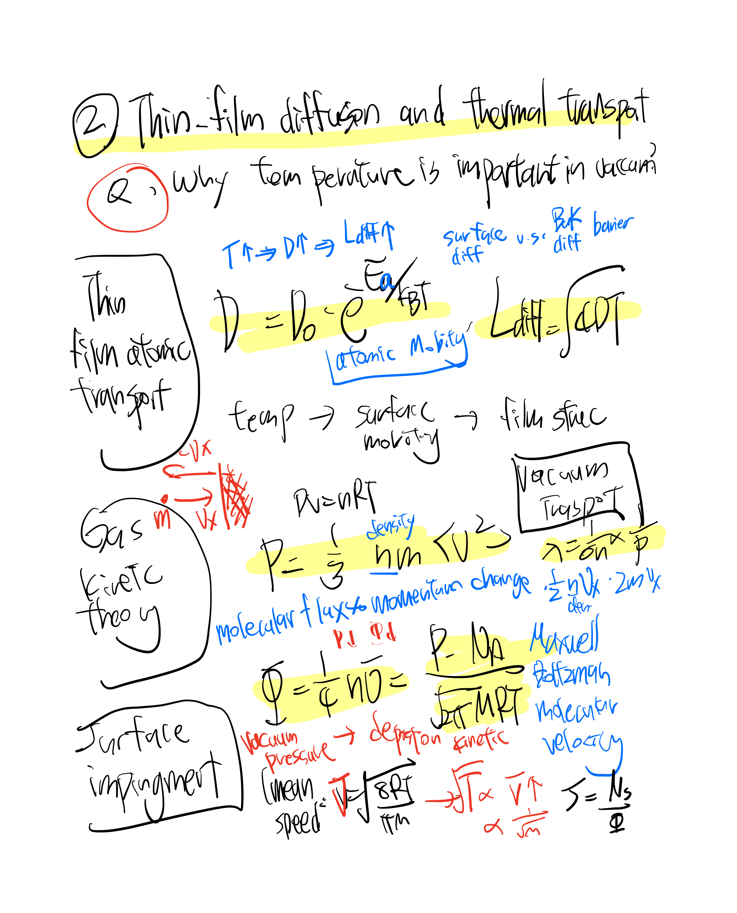
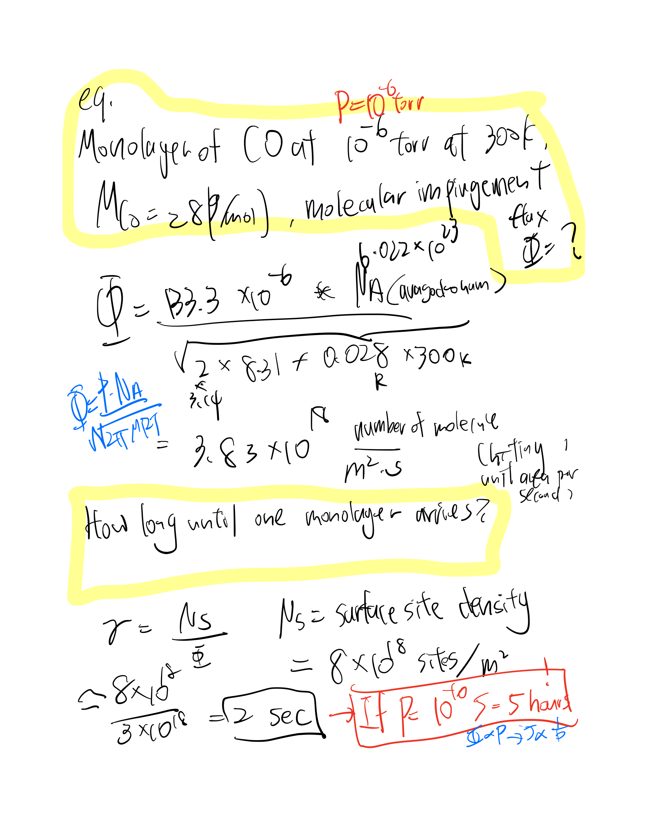

# MATSCI123-Electronic-Materials-Processing

## Textbook Source 
Dopants and Defects in Semiconductors 
Electronic Properties of Materials (Rolf E. Hummel)
Materials Science of Thin Films. Deposition and Structure (Ohring)

## Concepts
Solid State Physics (Band, defects in semiconductor and oxides,) -> bulk semiconductor crystal growth and processing : doping , diffusion , implantation -> thin film deposition and processing -> Material Analysis and Characterization

- **Semiconductor physics** -photon energy, phonon energy, energy vs momentum (k) diagram for an indirect bandgap semiconductor, Carrier mobility and applied electronic field, current-voltage (I-V) curve for a pn junction, electron concentration and inverse temperature for an intrinsic semiconductor
- **Electronic material processing**:  Control over how atoms, elec
- Gases, vacuum, pressure I
- Gases, vacuum, pressure II
- Physical vapor deposition (thermal & e-beam)
- Sputtering I & II
- MBE, PLD
- CVD
- Epitaxy I & II
- Ion implantation and annealing I & II
- Lithography and etching
- Oxidation
- Characterization – chemical, structural, electrical, optical

## Discusion 0: Those structural change modify electronic properties , device properties 
- Review 1- Electronic Materials Processing /  Solid State Science
PN and Metal-Semiconductor Junctions

  
1. Energy Band Structure: How they formed and what they mean: Reciprocal solid atom lattice with overlap atomic orbital forms molecular orbitals -> Bond gap diagram (Conduciton/ Valence Band) for Metal v.s. semiconductor / insulator 
1.1 Reciprocal Lattice (Momentum-Space) - k : wavenumber 
1.2 Semiconductor trends
2. Intrinsic and Extrinsic Semiconductor
2.1 Electron and Holes
2.2 Dopant and free carrier in Silicon
2.3 Effective Mass
2.4 Density of States
2.5 Fermi-Dirac Distribution Function for energy distribution
2.6 Carrier Concentration / acceptor , donor, effective mass, fermi function
2.7 Drift and Diffusion current mechanism (Electric field, Diffusion)

3.Semiconductor Junction and Contacts

---

## Applied Materials Characterization Project — Silicon Dioxide (SiO₂) in UCSD- Materials Research Science and Engineering Center

This experimental materials analysis project attached in aim to connect semiconductor processing fundamentals  ,which I characterized a hydrated SiO₂ submicron particle system using complementary chemical, structural, surface, colloidal, morphological, and thermal techniques.

The project applies concepts from electronic materials processing and semiconductor characterization through FTIR, Raman spectroscopy, SEM, DLS, zeta potential, contact-angle analysis, XRF, TGA, and DSC. The combined results were used to evaluate Si–O–Si bonding, surface hydroxylation, particle size and aggregation, surface charge, composition, and thermal behavior.

This project demonstrates the relationship:

Processing / Material State → Structure & Surface Chemistry → Measured Properties → Characterization & Interpretation

## View Full SiO₂ Characterization Project -> [UCSD-MRSEC Project](https://docs.google.com/document/d/1n6j6AtY1mRAR7bK_CfmxCuf1xAbGKlog/edit?usp=sharing&ouid=108924249682329290569&rtpof=true&sd=true)

---

## Practice 

Find one scientific article in a peer-reviewed journal that discusses the layered semiconductor germanium disulfide,EqGeS2. i) Identify and describe the synthesis process including synthesis method and conditions (e.g., synthesis/processing temperatures, pressure, source materials, etc.). ii) What properties are explored (chemical, electrical, optical, etc.)? iii) What techniques are used to explore these properties? iv) Are there additional processing conditions (e.g., metals used to form electrical contacts, surface treatments, etc.)

## Notes: Flux is so important in impringement! 
## Discussion 1: Why under lower pressure (Better Vaccuum), the thin film of silicon survive longer ? 

## Discussion 2 : How long it might take to create a vaccuum? 
- (Thin film evaporation process, Discharge , plasmas and ion-surface interaction,Plasma and Ion Beam Processing of Thin Films  / materials science of thin films ch3,4,5 ,Ohring)

- Topics: Electronic Structure -> vaporized atoms/molecules -> gas/vacuum transport -> arrival at substrate  -> condensation/film growth / removal -> device properties**
- **Concept flow**:  Vacuum -> source evaporation -> atomic flux ->  transport to substrate -> film thickness/uniformity  -> conformality
- Why heat up cause evaporation?
- What happens after atom evaporate ? / How deposition happens?
- Evaporation is a physical deposition process  

## Discussion 3 

- Clausins - Claphyeron relation

## Handout 1 Concepts: Thin Films, Gas Kinetics, Vacuum

1. **Thin Film Operations:** Add / Deposition, Remove / Etching, Modify / Surface Treatment
2. **Thin Film Definition:**
   A layer of material that meets one or more of the following criteria:
   - **i) Synthesis:** Vapor- or liquid-phase transport of atoms or molecules to a substrate whereby the film forms via attachment (deposition) onto and/or reaction at the surface.
   - **ii) Microstructure:** Layer morphology is governed by its interaction with the substrate.
   - **iii) Properties / Functionality:** Not attainable in bulk form.
3. **What makes thin film growth different from bulk?**
   Activation Energy Barrier:
   $$E_{\text{bulk}} \sim 4\text{ eV}, \qquad E_{\text{surface}} \sim 1\text{ eV}$$

   - **Diffusivity:**
     $$D = D_0 \exp\left(-\frac{E_a}{k_B T}\right)$$
     $$L_{\text{diff}} = \sqrt{4Dt}$$
     $$E_a \downarrow \; \Rightarrow \; D \uparrow \; \Rightarrow \; L_{\text{diff}} \uparrow$$

4. If we want to understand gas-based growth, we must understand the motion/flow of atoms and molecules in the gas phase in space.## Handout 1 Concepts: Thin Films, Gas Kinetics, Vacuum

1. **Thin Film Operations:** Add / Deposition, Remove / Etching, Modify / Surface Treatment
2. **Thin Film Definition:**
   A layer of material that meets one or more of the following criteria:
   - **i) Synthesis:** Vapor- or liquid-phase transport of atoms or molecules to a substrate whereby the film forms via attachment (deposition) onto and/or reaction at the surface.
   - **ii) Microstructure:** Layer morphology is governed by its interaction with the substrate.
   - **iii) Properties / Functionality:** Not attainable in bulk form.
3. **What makes thin film growth different from bulk?**
   Activation Energy Barrier:
   $$E_{\text{bulk}} \sim 4\text{ eV}, \qquad E_{\text{surface}} \sim 1\text{ eV}$$

   - **Diffusivity:**
     $$D = D_0 \exp\left(-\frac{E_a}{k_B T}\right)$$
     $$L_{\text{diff}} = \sqrt{4Dt}$$
     $$E_a \downarrow \; \Rightarrow \; D \uparrow \; \Rightarrow \; L_{\text{diff}} \uparrow$$

4. If we want to understand gas-based growth, we must understand the motion/flow of atoms and molecules in the gas phase in space. Microscopic kinetic gas pressure  $$\[P=(\text{flux})(\text{momentum change per molecule})\]$$ $$= \[P=\left(\frac12 nv_x\right)(2mv_x)\]$$ $$\[{\overline{v_x^2}=\overline{v_y^2}=\overline{v_z^2}=\frac13\overline{v^2}}\\]$$ , $$\[{P=\frac13n\overline{v^2}\frac{M}{N_A}}.\]$$

## HW Practices
### 1: Derive Mean molecular gas kinetic energy with molecular collision from Bolzman probability distribution of Velocity to Ideal gas equation
Two form of Ideal gas density, 1 use **number density of gas molecule** n per **avogadro number**, one use number of moles / amount of gas molecules

### 2: Create Vacuum Chamber system by cryopump with aperture and Mechanical Pump by pressure difference for Pulsed Laser Deposition

### 3: Deposition Rate 

### 4

# Semiconductor Physics
## Concepts: electronic band structure, reciprocal lattice, semiconductor alloys, effective mass, density of states, Fermi–Dirac statistics, and intrinsic/extrinsic semiconductors.

## 1. Band Structure

### 1.1 How energy bands form in solids

- An isolated atom has discrete electronic energy levels.
- As many atoms come together in a crystal, orbital interactions split the levels into many closely spaced states, forming **energy bands**.
- The **valence band (VB)** contains the highest occupied states at zero temperature for a semiconductor, while the **conduction band (CB)** contains higher-energy states into which electrons can be excited.
- The **bandgap** is the energy difference between the conduction-band minimum and valence-band maximum:

$$
\boxed{E_g = E_C-E_V}
$$

Here $E_C$ and $E_V$ denote the relevant band edges, not entire bands.

| Material type | Qualitative band structure |
|---|---|
| Metal | Partially filled band and/or overlapping valence and conduction bands; no gap at the Fermi level |
| Semiconductor | Relatively small bandgap; thermal or optical excitation can generate carriers |
| Insulator | Typically large bandgap, making carrier excitation difficult at ordinary temperatures |

> **Important:** Metals are not defined solely by a literal overlap of two bands; a partially filled band also gives metallic behavior.

### 1.2 Reciprocal lattice and $E(k)$ diagrams

- The real-space crystal lattice is periodic, and reciprocal-space vectors describe this periodicity in wavevector space.
- For a lattice translation $\mathbf R$ and reciprocal-lattice vector $\mathbf G$, $e^{i\mathbf G\cdot\mathbf R}=1$.
- A Bloch electron is labeled by a **crystal wavevector** $\mathbf k$; its crystal momentum is $\hbar\mathbf k$ (defined modulo a reciprocal-lattice vector), which is not generally identical to mechanical momentum.
- The energy dispersion $E_n(\mathbf k)$ gives the allowed energy in band $n$ at wavevector $\mathbf k$.
- Band energies satisfy periodicity in reciprocal space:

$$
\boxed{E_n(\mathbf k+\mathbf G)=E_n(\mathbf k)}
$$

- The **first Brillouin zone** is the Wigner–Seitz cell of the reciprocal lattice.
- Band dispersion determines carrier velocity and effective mass:

$$
\mathbf v_n(\mathbf k)=\frac{1}{\hbar}\nabla_{\mathbf k}E_n(\mathbf k)
$$

### 1.3 Trends in semiconductor bandgaps

**Temperature dependence (common trend):** Semiconductor bandgaps usually decrease as temperature increases, due to electron–phonon interactions and lattice expansion. A widely used *empirical approximation* is the Varshni relation:

$$
\boxed{E_g(T)=E_g(0)-\frac{\alpha T^2}{T+\beta}}
$$

where $\alpha$ and $\beta$ are material-dependent fitting parameters.

**Composition and bonding:** Within selected related semiconductor families, a larger lattice constant often correlates with a smaller gap. Increasing bond ionicity can also correlate with a larger gap. **Neither trend is a universal law**, so comparisons such as AlN, GaN, GaP, GaAs, GaSb, and InSb should be treated as illustrative and dependent on crystal structure and material family.

### 1.4 Semiconductor alloys: Vegard's law and bandgap bowing

For an alloy $A_{1-x}B_x$ with composition $0\le x\le1$:

**Vegard's law** (approximate linear lattice-constant interpolation):

$$
\boxed{a(x)\approx(1-x)a_A+xa_B}
$$

**Bandgap bowing** (composition-dependent gap):

$$
\boxed{E_g(x)=(1-x)E_{g,A}+xE_{g,B}-b\,x(1-x)}
$$

where $b$ is the bowing parameter (typically expressed in eV). The formula allows a nonlinear bandgap even if the lattice constant approximately follows Vegard's law.

- Example: $\mathrm{ZnSe}_{1-x}\mathrm{S}_x$ (substitution of S for Se on the anion sublattice).
- Applications: bandgap engineering, optoelectronics, LEDs, lasers, photodetectors, and photovoltaics.

## 2. Intrinsic and Extrinsic Semiconductors

### 2.1 Electron–hole pair generation

- Absorption of a photon can excite an electron from the valence band into the conduction band, leaving behind a **hole** in the valence band.
- For direct allowed band-to-band absorption, the basic energy threshold is:

$$
\boxed{h\nu\ge E_g}
$$

- A photon above the gap does **not** guarantee absorption: optical selection rules, transition probability, and momentum conservation also matter; indirect-gap materials often require phonon assistance.
- Electron–hole generation and recombination change carrier populations.

### 2.2 Dopants in silicon

| Type | Example dopants in Si | Level | Dominant mobile carrier | Ionized dopant charge |
|---|---|---|---|---|
| n-type | P, As, Sb (donors) | Donor level $E_D$ slightly below $E_C$ | Electrons | $D^+$ |
| p-type | B, Al (acceptors) | Acceptor level $E_A$ slightly above $E_V$ | Holes | $A^-$ |

- **Extrinsic** semiconductors are intentionally doped with donors and/or acceptors.
- With fully ionized dopants and in thermal equilibrium, charge neutrality gives:

$$
\boxed{p+N_D^+=n+N_A^-}
$$

- When a single dopant type dominates and intrinsic carriers are negligible:

$$
n\approx N_D-N_A \quad \text{(net n-type, full ionization)}
$$

$$
p\approx N_A-N_D \quad \text{(net p-type, full ionization)}
$$

These approximations are not valid in every temperature or doping regime (e.g., freeze-out, heavy degeneracy).

### 2.3 Effective mass of electrons and holes

The effective mass describes how charge carriers accelerate under applied forces while moving through a periodic crystal potential.

For a **one-dimensional parabolic band**:

$$
\boxed{m^*=\frac{\hbar^2}{\displaystyle\frac{d^2E}{dk^2}}}
$$

where $\hbar=h/(2\pi)$ and $k$ is wavevector in $\mathrm{m}^{-1}$.

- **Large curvature** $|d^2E/dk^2|$ $\Rightarrow$ **small magnitude** of effective mass.
- **Small curvature** $\Rightarrow$ **large magnitude** of effective mass.
- At a conduction-band minimum the curvature is positive, producing a positive electron effective mass.
- At a valence-band maximum the electron-band curvature is negative; describing the missing electron as a **hole** gives a positive hole effective mass near a simple parabolic maximum.
- In an anisotropic crystal, effective mass is a **tensor**:

$$
\boxed{(m^{*-1})_{ij}=\frac{1}{\hbar^2}\frac{\partial^2 E}{\partial k_i\partial k_j}}
$$

> **Exam intuition:** Sharply curved/narrow $E$–$k$ parabola $\rightarrow$ light effective mass; broad/flat parabola $\rightarrow$ heavy effective mass. **Transport effective mass** and **density-of-states effective mass** are not always the same, especially for anisotropic or multivalley bands.

### 2.4 Density of states (DOS)

The density of states $g(E)$ counts **available electronic states per unit energy per unit volume**:

$$
\boxed{g(E)\approx\frac{\Delta N_{\mathrm{states}}}{V\,\Delta E}}
$$

Units: $\mathrm{cm}^{-3}\,\mathrm{eV}^{-1}$ (or $\mathrm{m}^{-3}\,\mathrm{J}^{-1}$ with a consistent unit system).

For an isotropic **3D parabolic band**, including spin degeneracy:

$$
\boxed{g_C(E)=\frac{1}{2\pi^2}\left(\frac{2m_{n,\mathrm{DOS}}^*}{\hbar^2}\right)^{3/2}\sqrt{E-E_C},\quad E\ge E_C}
$$

$$
\boxed{g_V(E)=\frac{1}{2\pi^2}\left(\frac{2m_{p,\mathrm{DOS}}^*}{\hbar^2}\right)^{3/2}\sqrt{E_V-E},\quad E\le E_V}
$$

Here the DOS effective masses must account for the relevant equivalent valleys and/or valence bands if using these simplified forms.

### 2.5 Fermi–Dirac distribution

The probability that an **available electronic state** at energy $E$ is occupied is:

$$
\boxed{f(E)=\frac{1}{1+\exp\left(\frac{E-E_F}{k_BT}\right)}}
$$

where $E_F$ is the Fermi level (electron chemical potential in thermal equilibrium).

Key results:

$$
\boxed{f(E_F)=\frac12}\qquad (T>0)
$$

- $E\gg E_F$: $f(E)\rightarrow0$.
- $E\ll E_F$: $f(E)\rightarrow1$.
- Raising temperature broadens the transition around $E_F$; it does not change $f(E_F)=1/2$ for a fixed $E_F$.
- Hole occupancy probability is **$1-f(E)$**.

**Boltzmann (nondegenerate) approximations**, sufficiently far from the Fermi level:

$$
f(E)\approx e^{-(E-E_F)/(k_BT)}\qquad (E-E_F\gg k_BT)
$$

$$
1-f(E)\approx e^{-(E_F-E)/(k_BT)}\qquad (E_F-E\gg k_BT)
$$

At $300\ \mathrm K$, $k_BT\approx0.0259\ \mathrm{eV}$.

### 2.6 Electron and hole concentrations

**Concept: available states $\times$ occupation probability, integrated over energy.**

Exact equilibrium carrier integrals:

$$
\boxed{n=\int_{E_C}^{\infty}g_C(E)f(E)\,dE}
$$

$$
\boxed{p=\int_{-\infty}^{E_V}g_V(E)[1-f(E)]\,dE}
$$

For nondegenerate semiconductors with approximately parabolic bands:

$$
\boxed{n\approx N_C\exp\left(-\frac{E_C-E_F}{k_BT}\right)}
$$

$$
\boxed{p\approx N_V\exp\left(-\frac{E_F-E_V}{k_BT}\right)}
$$

Here **$N_C$ and $N_V$ are effective densities of states**, not the energy-resolved DOS $g(E)$:

$$
\boxed{N_C=2\left(\frac{2\pi m_{n,\mathrm{DOS}}^*k_BT}{h^2}\right)^{3/2}}
$$

$$
\boxed{N_V=2\left(\frac{2\pi m_{p,\mathrm{DOS}}^*k_BT}{h^2}\right)^{3/2}}
$$

- $n$: conduction-electron concentration ($\mathrm{cm}^{-3}$).
- $p$: valence-hole concentration ($\mathrm{cm}^{-3}$).
- $N_C,N_V\propto T^{3/2}$ if the effective masses are treated as temperature independent.
- For the exponent, use **the same energy units** for $E$, $E_F$ and $k_BT$ (e.g., all in eV).
- For the effective-DOS formulas, use a consistent SI unit system if $h$ is in J·s.

**Physical trend:** Moving $E_F$ toward $E_C$ increases $n$; moving $E_F$ toward $E_V$ increases $p$.

### 2.7 Intrinsic semiconductors and the mass-action law

An **intrinsic semiconductor** has negligible electrically active impurities, so thermally generated electron and hole concentrations are equal:

$$
\boxed{n=p=n_i}
$$

Using the nondegenerate carrier equations gives:

$$
\boxed{np=N_CN_V\exp\left(-\frac{E_g}{k_BT}\right)=n_i^2}
$$

Therefore:

$$
\boxed{n_i=\sqrt{N_CN_V}\exp\left(-\frac{E_g}{2k_BT}\right)}
$$

**Important conditions:** The usual $np=n_i^2$ relation applies to a material in *thermal equilibrium* under nondegenerate semiconductor statistics; illumination, injected carriers, or strongly degenerate conditions require additional care. At a fixed temperature and in the usual dilute-doping regime, $n_i$ is a material property rather than a function of dopant concentration.

The intrinsic Fermi level is:

$$
\boxed{E_i=\frac{E_C+E_V}{2}+\frac{k_BT}{2}\ln\left(\frac{N_V}{N_C}\right)}
$$

For simple bands this may also be written as:

$$
E_i=\frac{E_C+E_V}{2}+\frac{3}{4}k_BT\ln\left(\frac{m_{p,\mathrm{DOS}}^*}{m_{n,\mathrm{DOS}}^*}\right)
$$

Thus **$E_i$ is near midgap, but is exactly at midgap only if $N_C=N_V$.**

**Illustrative approximate values near $300\ \mathrm K$** (vary with sample, temperature, and source):

| Material | $E_g$ (eV) | $n_i$ ($\mathrm{cm}^{-3}$) |
|---|---:|---:|
| Ge | 0.67 | $\sim 2\times10^{13}$ |
| Si | 1.12 | $\sim 1\times10^{10}$ |
| GaAs | 1.42 | $\sim 2\times10^{6}$ |

> Values are rounded course-level estimates, not universal constants.

### 2.8 Doping, Extrinsic Semiconductors, and Charge Neutrality

#### 2.8.1 Charge neutrality and ionized dopants

At equilibrium, a macroscopically neutral, uniformly doped bulk semiconductor obeys

$$
\boxed{n+N_A^-=p+N_D^+}
$$

or equivalently

$$
\boxed{n+N_A^- -p-N_D^+=0.}
$$

- $n$: free conduction electrons, $p$: valence-band holes (both in $\mathrm{cm^{-3}}$).
- $N_D^+$: **ionized donors** (positively charged after donating an electron).
- $N_A^-$: **ionized acceptors** (negatively charged after accepting an electron).
- $N_D$, $N_A$: total donor and acceptor concentrations, which are not always equal to $N_D^+$ and $N_A^-$.  

> **Scope:** Local charge neutrality is a bulk approximation. It generally does not hold pointwise in depletion regions or space-charge layers; there Poisson's equation describes the charge distribution.

For **complete ionization**, $N_D^+\simeq N_D$ and $N_A^-\simeq N_A$, so

$$
\boxed{n-p=N_D-N_A.}
$$

Combine this with the nondegenerate, thermal-equilibrium mass-action law $np=n_i^2$:

$$
\boxed{n=\frac{(N_D-N_A)+\sqrt{(N_D-N_A)^2+4n_i^2}}{2}}
$$

$$
\boxed{p=\frac{(N_A-N_D)+\sqrt{(N_D-N_A)^2+4n_i^2}}{2}.}
$$

These formulas handle **compensated (counter-doped) semiconductors** and both carrier types.

#### 2.8.2 N-type and P-type limits

**N-type:** If $N_D-N_A\gg n_i$ and the dopants are fully ionized,

$$
\boxed{n\simeq N_D-N_A,\qquad p\simeq\frac{n_i^2}{N_D-N_A}.}
$$

**P-type:** If $N_A-N_D\gg n_i$ and the dopants are fully ionized,

$$
\boxed{p\simeq N_A-N_D,\qquad n\simeq\frac{n_i^2}{N_A-N_D}.}
$$

The inequalities establish when majority-carrier concentrations are approximately the **net dopant** concentrations—not necessarily the individual dopant concentrations.

#### 2.8.3 How doping shifts the Fermi level

With Boltzmann (nondegenerate) carrier statistics,

$$
\boxed{n=N_C\exp\!\left(-\frac{E_C-E_F}{k_BT}\right)}
$$

Taking logarithms and rearranging:

$$
\ln\!\left(\frac{n}{N_C}\right)=-\frac{E_C-E_F}{k_BT}
$$

$$
\boxed{E_C-E_F=k_BT\ln\!\left(\frac{N_C}{n}\right).}
$$

Similarly for holes,

$$
\boxed{p=N_V\exp\!\left(-\frac{E_F-E_V}{k_BT}\right)}
$$

$$
\boxed{E_F-E_V=k_BT\ln\!\left(\frac{N_V}{p}\right).}
$$

**At fixed temperature:** N-type doping raises $n$, moving $E_F$ **toward $E_C$**; P-type doping raises $p$, moving $E_F$ **toward $E_V$**. These logarithmic equations become inaccurate when the Fermi level enters a band (degenerate doping), in which case Fermi–Dirac integrals are needed.

Relative to the intrinsic Fermi level $E_i$:

$$
\boxed{n=n_i\exp\!\left(\frac{E_F-E_i}{k_BT}\right),\qquad
p=n_i\exp\!\left(\frac{E_i-E_F}{k_BT}\right).}
$$

#### 2.8.4 Temperature regimes: freeze-out, extrinsic, intrinsic

A plot of $\ln n$ against $1/T$ often shows three approximate regimes for donor-doped material:

| Regime | Mechanism | Approximate $n(T)$ | $\ln n$ vs. $1/T$ |
|---|---|---|---|
| Low $T$: **freeze-out** | Donors are only partially ionized | $\propto T^{3/4}e^{-(E_C-E_D)/(2k_BT)}$ in the simplified asymptotic limit below | Negative slope approximately $-(E_C-E_D)/(2k_B)$ |
| Intermediate $T$: **extrinsic plateau** | Donors substantially ionized, intrinsic carriers negligible | $n\simeq N_D-N_A$ | Approximately horizontal, slope $\simeq0$ |
| High $T$: **intrinsic** | Thermal electron–hole pairs dominate | $n\simeq n_i\propto T^{3/2}e^{-E_g/(2k_BT)}$ for fixed gap and masses | Negative approximate slope $-E_g/(2k_B)$ |

Because $1/T$ runs from **high temperature on the left** to **low temperature on the right**, interpret the plot axis carefully.

**Donor freeze-out derivation** (negligible acceptors and holes, nondegenerate electrons):

One common donor occupancy convention is

$$
N_D^+=\frac{N_D}{1+g_D\exp[(E_F-E_D)/(k_BT)]}.
$$

Here $g_D$ is the donor degeneracy factor under this convention (commonly $g_D=2$). In the freeze-out limit, when $g_D\exp[(E_F-E_D)/(k_BT)]\gg1$,

$$
\boxed{N_D^+\simeq\frac{N_D}{g_D}\exp\!\left(-\frac{E_F-E_D}{k_BT}\right).}
$$

Using charge neutrality $n\simeq N_D^+$ and the conduction-electron formula,

$$
n=N_C\exp\!\left(-\frac{E_C-E_F}{k_BT}\right)
\simeq\frac{N_D}{g_D}\exp\!\left(-\frac{E_F-E_D}{k_BT}\right).
$$

Multiply the two expressions for $n$ to eliminate $E_F$:

$$
\boxed{n^2\simeq\frac{N_CN_D}{g_D}\exp\!\left(-\frac{E_C-E_D}{k_BT}\right).}
$$

Thus

$$
\boxed{n\simeq\sqrt{\frac{N_CN_D}{g_D}}\exp\!\left(-\frac{E_C-E_D}{2k_BT}\right).}
$$

Define the donor activation energy $\Delta E_D=E_C-E_D$. Since $N_C(T)\propto T^{3/2}$,

$$
\ln n \simeq \underbrace{\text{constant}+\frac34\ln T}_{\text{slowly varying prefactor}}
-\frac{\Delta E_D}{2k_B}\frac1T.
$$

Treating the prefactor as approximately constant gives

$$
\boxed{\frac{d(\ln n)}{d(1/T)}\simeq-\frac{\Delta E_D}{2k_B}.}
$$

More accurately, if $\Delta E_D$ and effective mass are temperature independent,

$$
\frac{d(\ln n)}{d(1/T)}\simeq-\frac{\Delta E_D}{2k_B}-\frac34T.
$$

At the **extrinsic plateau**, $n\simeq N_D-N_A$ is nearly independent of temperature, and therefore

$$
\boxed{\frac{d(\ln n)}{d(1/T)}\simeq0.}
$$

> **Exam caution:** The freeze-out formula assumes a single shallow donor species and negligible compensation. Degeneracy conventions for $g_D$ differ across textbooks; use a consistent definition. Also, the plateau slope is approximate, not a universal exact zero.

#### 2.8.5 Homework Practice — Q6: Phosphorus doping and boron counter-doping

**Given (silicon):** $n_i(300\,\mathrm K)=1.0\times10^{10}\,\mathrm{cm^{-3}}$, $E_g=1.12\,\mathrm{eV}$, $N_D=N_P=1.0\times10^{15}\,\mathrm{cm^{-3}}$. Use $k_B=8.61733\times10^{-5}\,\mathrm{eV/K}$, $N_C(300\,\mathrm K)=2.8\times10^{19}\,\mathrm{cm^{-3}}$, and $N_V(300\,\mathrm K)=1.04\times10^{19}\,\mathrm{cm^{-3}}$. Assume full dopant ionization throughout.

**(a) Is phosphorus a donor or acceptor?**  
Phosphorus is a Group V element with five valence electrons; substituting it for Group IV silicon introduces a shallow donor level. The wafer is **N-type** before counter-doping.

**(b) Find $n$, $p$, and $E_C-E_F$ at 300 K.**

$$
\boxed{n\simeq N_D=1.00\times10^{15}\,\mathrm{cm^{-3}}}
$$

$$
\boxed{p=\frac{n_i^2}{n}=1.00\times10^5\,\mathrm{cm^{-3}}}
$$

$$
\begin{aligned}
E_C-E_F&=k_BT\ln\!\left(\frac{N_C}{n}\right)\\
&=(8.61733\times10^{-5})(300)\ln\!\left(\frac{2.8\times10^{19}}{1.0\times10^{15}}\right)\\
&\boxed{\simeq0.265\,\mathrm{eV}.}
\end{aligned}
$$

**(c) Find boron concentration if the desired Fermi level is 0.35 eV below the intrinsic level at 300 K.**

The **most direct approach** avoids approximating $E_i$ as midgap:

$$
E_F=E_i-0.35\,\mathrm{eV},\qquad
p=n_i\exp\!\left(\frac{E_i-E_F}{k_BT}\right).
$$

$$
\begin{aligned}
p&=(1.0\times10^{10})\exp\!\left(\frac{0.35}{(8.61733\times10^{-5})(300)}\right)\\
&\boxed{\simeq7.58\times10^{15}\,\mathrm{cm^{-3}}.}
\end{aligned}
$$

The minority-electron concentration is $n=n_i^2/p\simeq1.32\times10^4\,\mathrm{cm^{-3}}$. With both boron acceptors and existing phosphorus donors fully ionized,

$$
p-n=N_B-N_P
$$

$$
\boxed{N_B=p-n+N_P\simeq8.58\times10^{15}\,\mathrm{cm^{-3}}.}
$$

**Why the earlier $7.97\times10^{15}$ answer was inconsistent:** It estimated $E_i-E_V\simeq E_g/2$ while simultaneously using an independent $N_V$. The exact $E_i$ follows $p=n_i$, i.e. $E_i-E_V=k_BT\ln(N_V/n_i)\simeq0.537$ eV for the given constants, rather than $0.560$ eV. In particular, $p=n_i e^{0.35/k_BT}$ is sufficient here.

**(d) Find $E_C-E_F$ at 600 K for the counter-doped wafer; keep $E_g$ constant.**

Assuming temperature-independent effective masses, $N_C$ and $N_V$ scale as $T^{3/2}$:

$$
N_C(600)=N_C(300)\left(\frac{600}{300}\right)^{3/2}
\simeq7.92\times10^{19}\,\mathrm{cm^{-3}}
$$

$$
N_V(600)\simeq2.94\times10^{19}\,\mathrm{cm^{-3}}.
$$

Use the **band-parameter expression** for intrinsic concentration at 600 K:

$$
\begin{aligned}
n_i(600)&=\sqrt{N_C(600)N_V(600)}\exp\!\left(-\frac{E_g}{2k_B(600)}\right)\\
&\boxed{\simeq9.55\times10^{14}\,\mathrm{cm^{-3}}.}
\end{aligned}
$$

Net acceptor concentration from part (c): $\Delta N=N_B-N_D\simeq7.58\times10^{15}\,\mathrm{cm^{-3}}$. Apply $p-n=\Delta N$ and $np=n_i(600)^2$:

$$
\boxed{p=\frac{\Delta N+\sqrt{\Delta N^2+4n_i(600)^2}}2
\simeq7.70\times10^{15}\,\mathrm{cm^{-3}}.}
$$

$$
\boxed{n=\frac{n_i(600)^2}{p}\simeq1.18\times10^{14}\,\mathrm{cm^{-3}}.}
$$

Finally,

$$
\begin{aligned}
E_C-E_F&=k_B(600)\ln\!\left(\frac{N_C(600)}{n}\right)\\
&\boxed{\simeq0.694\,\mathrm{eV}.}
\end{aligned}
$$

##  Quick Equation Sheet

| Quantity | Formula | Use / condition |
|---|---|---|
| Bandgap | $E_g=E_C-E_V$ | CB minimum minus VB maximum |
| Crystal electron group velocity | $\mathbf v=(1/\hbar)\nabla_{\mathbf k}E$ | Band dispersion |
| 1D effective mass | $m^*=\hbar^2/(d^2E/dk^2)$ | Parabolic-band approximation |
| Fermi–Dirac occupation | $f(E)=[1+e^{(E-E_F)/(k_BT)}]^{-1}$ | Equilibrium |
| Electron concentration | $n=N_Ce^{-(E_C-E_F)/(k_BT)}$ | Nondegenerate |
| Hole concentration | $p=N_Ve^{-(E_F-E_V)/(k_BT)}$ | Nondegenerate |
| Conduction effective DOS | $N_C=2(2\pi m_{n,\mathrm{DOS}}^*k_BT/h^2)^{3/2}$ | Parabolic bands |
| Valence effective DOS | $N_V=2(2\pi m_{p,\mathrm{DOS}}^*k_BT/h^2)^{3/2}$ | Parabolic bands |
| Mass-action law | $np=n_i^2$ | Thermal equilibrium, nondegenerate |
| Intrinsic carriers | $n_i=\sqrt{N_CN_V}e^{-E_g/(2k_BT)}$ | Thermal equilibrium, nondegenerate |
| Intrinsic Fermi level | $E_i=(E_C+E_V)/2+(k_BT/2)\ln(N_V/N_C)$ | Nondegenerate |
| Charge neutrality | $p+N_D^+=n+N_A^-$ | Equilibrium charge balance |
| Vegard's law | $a(x)\approx(1-x)a_A+xa_B$ | Approximate alloy interpolation |
| Bandgap bowing | $E_g(x)=(1-x)E_{g,A}+xE_{g,B}-bx(1-x)$ | Empirical alloy model |
| Temperature-dependent gap | $E_g(T)=E_g(0)-\alpha T^2/(T+\beta)$ | Empirical Varshni relation |

## 3. Semiconductor Junctions and Contacts (Lecture 1.3)

A **PN homojunction** is formed by adjoining p-type and n-type regions of the same semiconductor. Its equilibrium electrostatic potential emerges from redistribution of carriers—not from a supply of net charge by a battery.

$$
\boxed{\text{Doping contrast}\rightarrow\text{Carrier diffusion}\rightarrow\text{Exposed dopant ions}\rightarrow\text{Space-charge field}\rightarrow\text{Built-in potential and band bending}}
$$

> **Assumptions unless noted:** one-dimensional abrupt silicon PN junction, thermal equilibrium, nondegenerate statistics, fully ionized dopants, uniform doping outside the junction, and depletion approximation for electrostatics. Use $q>0$ for the **magnitude** of elementary charge, $k_B$ for Boltzmann's constant, and $\mathcal E$ for electric field.

### 3.1 Carrier transport: drift and diffusion

| Mechanism | Driving force | Carrier motion |
|---|---|---|
| Drift | Electric field $\mathcal E$ | Electrons drift **against** the field; holes drift **with** the field |
| Diffusion | Concentration gradient | Each carrier species moves from higher to lower concentration |

The conventional **current densities** in one dimension are

$$
\boxed{J_n=qn\mu_n\mathcal E+qD_n\frac{dn}{dx}}
$$

$$
\boxed{J_p=qp\mu_p\mathcal E-qD_p\frac{dp}{dx}}
$$

$$
\boxed{J=J_n+J_p}
$$

Here $J_n,J_p$ are in $\mathrm{A/m^2}$ (for SI inputs), $\mu$ is mobility ($\mathrm{m^2/(V\,s)}$), $D$ is diffusion coefficient ($\mathrm{m^2/s}$), and $n,p$ are number densities ($\mathrm{m^{-3}}$). If concentrations are in $\mathrm{cm^{-3}}$, use mobilities and diffusion coefficients consistently in centimeter-based units to obtain $\mathrm{A/cm^2}$.

**Why the electron diffusion term is positive:** electron **particle flux** is $\Gamma_n=-D_n\,dn/dx$; multiplying by electron charge $-q$ gives electron diffusion *conventional current* $J_{n,\mathrm{diff}}=qD_n\,dn/dx$. Hole charge is $+q$, yielding $J_{p,\mathrm{diff}}=-qD_p\,dp/dx$.

For a nondegenerate semiconductor, the **Einstein relation** links diffusion and mobility:

$$
\boxed{\frac{D_n}{\mu_n}=\frac{D_p}{\mu_p}=\frac{k_BT}{q}\equiv V_T}
$$

where $V_T$ is the *thermal voltage* ($\approx25.85\ \mathrm{mV}$ at $300\ \mathrm K$).

###  Formation of the depletion (space-charge) region

Take the **n-side on the left** and **p-side on the right**, with $x$ increasing to the right.

1. Electrons initially diffuse **n $\rightarrow$ p**, while holes diffuse **p $\rightarrow$ n**.
2. Near the interface, electrons leave behind immobile **positive donor ions** $D^+$ on the n-side, and holes leave behind immobile **negative acceptor ions** $A^-$ on the p-side.
3. The resulting space charge produces an electric field **n $\rightarrow$ p** (left to right). Its electron and hole drift contributions oppose their respective diffusion currents.
4. At **thermal equilibrium**, each species' net current vanishes even though its drift and diffusion contributions need not vanish individually:

$$
\boxed{J_n=0,\qquad J_p=0}\quad\text{(thermal equilibrium)}
$$

Within the depletion approximation, mobile $n$ and $p$ are neglected **in the space-charge region only**. The field is not zero there; it is generated by the ionized dopants. In the quasi-neutral regions, free carriers remain plentiful.

### 3.3 Built-in field, electrostatic potential, and band bending

Define electrostatic potential $\phi(x)$ with $\mathcal E(x)=-d\phi/dx$. For constant material electron affinity and bandgap,

$$
\boxed{E_C(x)=E_{C,0}-q\phi(x)},\qquad
\boxed{E_V(x)=E_{V,0}-q\phi(x)}
$$

> When energies are expressed in joules, $q\phi$ is in joules; for energies expressed in electronvolts, the numerical band-edge shift in eV equals minus the potential shift in volts.

For **n-left/p-right**, $\mathcal E>0$ through the depletion zone, hence $d\phi/dx<0$: both $E_C$ and $E_V$ **rise from n to p**. The Fermi level is flat at equilibrium:

$$
\boxed{E_F=\text{constant}},\qquad
\boxed{E_C(x)-E_V(x)=E_g}\quad\text{(homojunction)}
$$

Across the junction, if $\phi_{bi}=\phi_n-\phi_p>0$ is defined as the positive *built-in voltage*, then

$$
\boxed{E_C(p)-E_C(n)=E_V(p)-E_V(n)=q\phi_{bi}}
$$

**Built-in potential** for a nondegenerate, fully ionized, abrupt PN junction:

$$
\boxed{\phi_{bi}=\frac{k_BT}{q}\ln\left(\frac{N_AN_D}{n_i^2}\right)}
$$

Example at $300\ \mathrm K$: $N_A=10^{18}$, $N_D=10^{17}$, $n_i=10^{10}\ \mathrm{cm^{-3}}$:

$$
\phi_{bi}=0.02585\,\ln\left(\frac{10^{18}\cdot10^{17}}{(10^{10})^2}\right)
=0.02585\ln(10^{15})\approx\boxed{0.893\ \mathrm V}.
$$

Therefore the corresponding band-edge energy rise is about $0.893\ \mathrm{eV}$. **The built-in potential does not appear as a directly measurable terminal voltage in an equilibrium closed circuit** because contact potentials elsewhere compensate it.

### 3.4 Depletion widths and charge balance

For depletion distances $x_n>0$ into the n-side and $x_p>0$ into the p-side, neutrality of the depletion-region charge gives

$$
\boxed{qN_Dx_n=qN_Ax_p}\quad\Longrightarrow\quad
\boxed{\frac{x_n}{x_p}=\frac{N_A}{N_D}}.
$$

Total depletion width:

$$
\boxed{W=x_n+x_p
=\sqrt{\frac{2\varepsilon_s\phi_{bi}}{q}\left(\frac{1}{N_A}+\frac{1}{N_D}\right)}}
$$

The widths can be obtained individually:

$$
\boxed{x_n=\frac{N_A}{N_A+N_D}W},\qquad
\boxed{x_p=\frac{N_D}{N_A+N_D}W}.
$$

Here $\varepsilon_s$ is the **absolute semiconductor permittivity** ($\mathrm{F/m}$). Concentrations and distances must use a consistent unit system. **The more lightly doped side depletes further:** if $N_A/N_D=10$, then $x_n=10x_p$.

### 3.5 Effect of applied voltage

Define junction voltage $V\equiv V_p-V_n$, so **forward bias** means $V>0$ and **reverse bias** means $V<0$.

Under the ideal depletion approximation, the electrostatic barrier for majority carriers is

$$
\boxed{\phi_{\mathrm{barrier}}=\phi_{bi}-V},\qquad
\boxed{W(V)=\sqrt{\frac{2\varepsilon_s(\phi_{bi}-V)}{q}\left(\frac1{N_A}+\frac1{N_D}\right)}}.
$$

| Bias condition | Terminal connection | Barrier | Depletion width | Main effect |
|---|---|---|---|---|
| Equilibrium, $V=0$ | None | $\phi_{bi}$ | $W(0)$ | Drift and diffusion cancel for each carrier |
| Forward, $V=V_F>0$ | p positive relative to n | $\phi_{bi}-V_F$ | Decreases | Majority-carrier injection becomes easier |
| Reverse, $V=-V_R<0$ ($V_R>0$) | p negative relative to n | $\phi_{bi}+V_R$ | Increases | Majority-carrier injection is suppressed |

The expressions assume the depletion approximation remains valid; they are not accurate under strong forward injection or avalanche/Zener breakdown. **Away from equilibrium, a single flat Fermi level generally cannot describe both carrier populations**; electron and hole quasi-Fermi levels can differ.

### 3.6 Ideal diode equation and saturation current

For an ideal diffusion-dominated PN diode,

$$
\boxed{I=I_0\left[\exp\left(\frac{qV}{k_BT}\right)-1\right]}
$$

with ideality factor $1$. Real diodes may be described over a particular range by $I\approx I_0[\exp(qV/(\eta k_BT))-1]$, where $\eta$ is an empirical ideality factor and series resistance, recombination, and breakdown may matter.

For an **ideal long-base diode** with low-level injection and fully ionized dopants,

$$
\boxed{I_0=Aqn_i^2\left(\frac{D_p}{L_pN_D}+\frac{D_n}{L_nN_A}\right)}
$$

where $A$ is junction area, $D_n,D_p$ are minority-carrier diffusion coefficients, and $L_n,L_p$ are corresponding diffusion lengths ($L_n=\sqrt{D_n\tau_n}$ for minority electrons in p-type material, $L_p=\sqrt{D_p\tau_p}$ for minority holes in n-type material). Here $I_0$ has units of amperes.

- **Forward bias** ($V\gg V_T$): $I\approx I_0e^{qV/(k_BT)}$; minority-carrier concentration at the edges of the depletion region grows exponentially.
- **Moderate reverse bias** ($V\ll-V_T$): $I\approx-I_0$ in the ideal model, before breakdown. The diffusion of minority carriers through the quasi-neutral regions supplies this saturation current; the depletion-region field then sweeps arriving carriers across by **drift**.

> **Exam traps:** (1) *electron motion* and *electron conventional current* have opposite directions; (2) positive donor ions are on the **n-side**, negative acceptor ions on the **p-side**; (3) $J_n=J_p=0$ only at **thermal equilibrium** (not under an applied diode bias); (4) $\phi_{bi}$ is a voltage, whereas $q\phi_{bi}$ is an energy; (5) forward bias *reduces* the barrier and width; (6) neither the depletion approximation nor the ideal Shockley equation describes breakdown.

# Thin film Deposition and Epitaxy

## 4. Epitaxy: Lattice Mismatch, Strain Accommodation, and Critical Thickness

### 4.1 What is epitaxy?

**Epitaxy** is the growth of a crystalline film whose crystallographic orientation is related to that of the underlying substrate. Atomic bonding and the crystalline template at the interface guide the deposited film's orientation.

| Configuration | Physical meaning | Typical characteristic |
|---|---|---|
| **Lattice matched** | Film and substrate have equal (or nearly equal) relevant in-plane lattice spacing | Little or no mismatch strain |
| **Coherent / strained** | Film conforms to the substrate's in-plane lattice spacing | Elastic strain; no misfit dislocations at the ideal interface |
| **Relaxed** | Film accommodates mismatch without remaining fully coherent | May form misfit dislocations, islands, or other relaxation structures |

- **Homoepitaxy:** growth on the same material, e.g., Si on Si.
- **Heteroepitaxy:** growth on a different material, e.g., SiGe on Si.
- Coherent heteroepitaxy constrains the film's **in-plane** lattice parameter to match the substrate; out-of-plane spacing may change through the Poisson effect.

### 4.2 Lattice mismatch and mechanical strain

Using the **symmetric lattice-mismatch convention** from the lecture:

$$
\boxed{f=\frac{2(a_f-a_s)}{a_f+a_s}}
$$

For small mismatch:

$$
\boxed{f\approx\frac{a_f-a_s}{a_s}}
$$

where $a_f$ and $a_s$ are the *relaxed* lattice parameters of film and substrate, respectively. The second expression is a small-mismatch approximation, **not** an exact identity.

For a coherent film on a much thicker, effectively rigid substrate, its in-plane engineering strain (referenced to the unstrained film) is

$$
\boxed{\varepsilon_{\parallel}=\frac{a_s-a_f}{a_f}\approx-f.}
$$

| Mismatch | Relative lattice parameters | Coherent-film in-plane strain |
|---|---|---|
| $f>0$ | $a_f>a_s$ | Compressive: $\varepsilon_{\parallel}<0$ |
| $f<0$ | $a_f<a_s$ | Tensile: $\varepsilon_{\parallel}>0$ |
| $f=0$ | $a_f=a_s$ | No lattice-mismatch strain |

> **Exam pitfall:** The sign of the *lattice mismatch* and the sign of the *mechanical in-plane strain* are opposite under these definitions. Different references may define mismatch with the opposite sign, so always inspect the convention.

### 4.3 Four ways epitaxial films accommodate mismatch

| Mechanism | How it reduces the energy | Key consequence |
|---|---|---|
| **A. Elastic accommodation** | Film deforms without permanently breaking crystallographic coherence | Stored elastic strain energy |
| **B. Surface roughening / islanding** | Nonuniform geometry permits partial strain relaxation | Increased surface/interface area |
| **C. Interdiffusion** | Compositional grading changes the local relaxed lattice parameter | Mixed or graded interface |
| **D. Plastic relaxation** | Misfit dislocations introduce lattice slip at or near the interface | Permanent crystallographic defects |

These mechanisms can coexist. A coherent film is not necessarily relaxed, and a relaxed film need not relax *exclusively* through dislocations.

### 4.4 Total-energy model for plastic relaxation

In the simplified lecture model, the **total energy per unit substrate area** is

$$
\boxed{E_{\mathrm{total}}(L,h)=E_{\mathrm{el}}(L,h)+E_{\mathrm{dis}}(L,h)}
$$

with

$$
\boxed{E_{\mathrm{el}}=k_1h(f-k_2L)^2}
$$

$$
\boxed{E_{\mathrm{dis}}=k_3L\ln(k_4h)}.
$$

| Symbol | Physical interpretation | SI units |
|---|---|---|
| $h$ | Epitaxial-film thickness | m |
| $f$ | Initial lattice mismatch, signed using a chosen convention | 1 |
| $L$ | Total misfit-dislocation line length per unit interface area | m$^{-1}$ |
| $k_1$ | Elastic energy coefficient, of the order of a biaxial modulus | Pa = J m$^{-3}$ |
| $k_2$ | Effective mismatch-relieving Burgers-vector component | m |
| $k_3$ | Dislocation line-energy prefactor | J m$^{-1}$ |
| $k_4$ | Inverse characteristic core length (ensures dimensionless logarithm) | m$^{-1}$ |

In the **positive-mismatch** convention with appropriately oriented relaxing dislocations,

$$
\boxed{f_{\mathrm{res}}=f-k_2L.}
$$

This simplified expression assumes $L\ge0$, $k_2>0$, and a dislocation orientation that actually relieves the mismatch. For negative mismatch, choose the opposite relieving Burgers-vector sign or reformulate the model using $|f|$.

**Energy tradeoff:**

- Without dislocations, $L=0$, so $E_{\mathrm{el}}(0,h)=k_1hf^2$.
- Adding correctly oriented dislocations reduces $|f_{\mathrm{res}}|$ and therefore the elastic energy initially.
- Creating dislocations also costs line energy; the logarithmic approximation must be used only within its physically meaningful range (in particular, where $\ln(k_4h)>0$).

### 4.5 Derive the critical thickness $h_c$

The model defines the onset of energetically favorable dislocation introduction by the **one-sided derivative at the coherent state**:

$$
\boxed{\left.\frac{\partial E_{\mathrm{total}}}{\partial L}\right|_{L\to0^+}=0.}
$$

**Step 1 — Substitute both energy terms.**

$$
E_{\mathrm{total}}=k_1h(f-k_2L)^2+k_3L\ln(k_4h).
$$

**Step 2 — Differentiate with respect to $L$, keeping $h$ fixed.**

$$
\begin{aligned}
\frac{\partial E_{\mathrm{total}}}{\partial L}
&=2k_1h(f-k_2L)(-k_2)+k_3\ln(k_4h)\\
&=\boxed{-2k_1k_2h(f-k_2L)+k_3\ln(k_4h)}.
\end{aligned}
$$

**Step 3 — Evaluate at the dislocation-free state, $L=0$.**

$$
\left.\frac{\partial E_{\mathrm{total}}}{\partial L}\right|_{L=0^+}
=-2k_1k_2hf+k_3\ln(k_4h).
$$

**Step 4 — Set the derivative to zero at $h=h_c$.**

$$
-2k_1k_2h_cf+k_3\ln(k_4h_c)=0
$$

$$
2k_1k_2h_cf=k_3\ln(k_4h_c).
$$

Rearranging gives the **implicit critical-thickness equation**:

$$
\boxed{h_c=\frac{k_3}{2k_1k_2f}\ln(k_4h_c)}
\qquad (f>0,\ \text{relieving orientation}).
$$

When using the corresponding mismatch-relieving magnitude, the commonly quoted form is

$$
\boxed{h_c=\frac{k_3}{2k_1k_2|f|}\ln(k_4h_c).}
$$

The coefficient units are consistent: $k_3/(k_1k_2)$ has units of length, and $k_4h_c$ is dimensionless.

**Interpret the derivative's sign:**

- If $\left.\partial E_{\mathrm{total}}/\partial L\right|_{0^+}>0$, creating an infinitesimal density of dislocations raises the energy; the coherent state is locally favorable.
- If $\left.\partial E_{\mathrm{total}}/\partial L\right|_{0^+}<0$, a small density of relaxing dislocations lowers the energy; the coherent state is no longer locally favorable.
- Equality defines the *onset condition* in this model, subject to the range of validity of its logarithmic line-energy expression.

### 4.6 Physical interpretation and limits

The key trend for the physically relevant, thicker-film critical-thickness branch is

$$
\boxed{\text{Larger }|f|\ \Longrightarrow\ \text{smaller equilibrium critical thickness }h_c.}
$$

**Why?** Elastic energy per area scales as $hf^2$ for a fully coherent film, so a more mismatched film has a larger strain-energy penalty and becomes energetically motivated to relax at smaller thickness.

**Important qualifications:**

1. This equation is **implicit**; $h_c$ appears both inside and outside the logarithm, so numerical iteration or root finding is usually used.
2. The logarithmic approximation can yield mathematically multiple roots or no physical root for some parameter choices. Choose only a solution within the model's thickness and core-length validity range; the thicker-film branch is the one normally associated with relaxation onset.
3. The result predicts an **energetic/equilibrium onset**, not necessarily the experimentally observed thickness. Dislocation nucleation barriers and growth kinetics can preserve metastable coherency beyond the predicted threshold.
4. Numerical values of $k_1,\ldots,k_4$ and the dislocation geometry are necessary for a **quantitative** prediction for a particular materials system (such as SiGe/Si).

**Illustrative only:** A chart that reports an arbitrary-unit critical thickness (e.g., 64.46 at 1% mismatch) without specifying the coefficients should not be interpreted as a thickness in nanometers or as a real SiGe/Si prediction.

### 3.7 Quick equation review

| Concept | Equation |
|---|---|
| Symmetric lattice mismatch | $\displaystyle f=\frac{2(a_f-a_s)}{a_f+a_s}$ |
| Small-mismatch approximation | $\displaystyle f\approx\frac{a_f-a_s}{a_s}$ |
| Coherent-film in-plane strain | $\displaystyle \varepsilon_{\parallel}=\frac{a_s-a_f}{a_f}\approx-f$ |
| Residual mismatch | $\displaystyle f_{\mathrm{res}}=f-k_2L$ |
| Elastic energy per area | $\displaystyle E_{\mathrm{el}}=k_1h(f-k_2L)^2$ |
| Dislocation energy per area | $\displaystyle E_{\mathrm{dis}}=k_3L\ln(k_4h)$ |
| Onset criterion | $\displaystyle \left.\partial E_{\mathrm{total}}/\partial L\right|_{0^+}=0$ |
| Critical thickness | $\displaystyle h_c=\frac{k_3}{2k_1k_2|f|}\ln(k_4h_c)$ |

 ### HW4 Q4> CVD
	A silicon thin film is deposited through the thermal decomposition of silane:
SiH4g→Sis+2H2g
(1 pt.) Explain the difference between a surface reaction-controlled and a diffusion-controlled CVD process.
(1 pts.) For a sR=R0e-Ea/kBTIf the activation energy is 1.0 eV, calculate the ratio of deposition rates at 700 K and 800 K.
(1 pt.) Explain why increasing the temperature beyond a certain point may no longer significantly increase the deposition rate.urface reaction-controlled process, the deposition rate primarily follows an Arrhenius relationship:

(a) Surface reaction-controlled CVD is limited by the chemical reaction at the substrate (\(k_s\ll h_g\)), while diffusion-controlled CVD is limited by reactant transport through the gas boundary layer (\(k_s\gg h_g\)).

(b)
$$
\boxed{\frac{R_{800}}{R_{700}}=7.94}\
$$

The deposition rate at 800 K is approximately 7.94 times higher.

(c) At high temperatures, the process transitions from surface-reaction-controlled to diffusion-controlled growth. Reactant mass transport becomes the bottleneck, so further heating has a smaller effect on deposition rate.

---
## 5. Sputtering and Plasma Processing (PVD)

> **Key concept:** Deposited atoms originate from the **target**, not the substrate. Most sputtered species are **neutral atoms**; a smaller fraction may be ionized.

### 5.1 Mechanism: plasma to deposited film

$$
\boxed{\text{Plasma generation}\rightarrow\text{Ion acceleration}\rightarrow\text{Target sputtering}\rightarrow\text{Transport}\rightarrow\text{Film growth}}
$$

1. **Ionization:** $\mathrm{Ar}+e^-\rightarrow\mathrm{Ar}^++2e^-$.
2. **Acceleration:** positive argon ions cross the sheath toward a negatively biased target. The force is $\mathbf F=q\mathbf{\mathcal E}$, and their approximate energy gain is

   $$E_{\mathrm{ion}}\simeq e(V_{\mathrm{plasma}}-V_{\mathrm{target}}).$$

3. **Sputtering:** ion impact initiates collision cascades that eject target atoms.
4. **Transport and growth:** ejected species reach the substrate and condense. Adding reactive gas (e.g., $\mathrm O_2$ or $\mathrm N_2$) can form oxides or nitrides.

### 5.2 Sputter yield and collision energetics

$$
\boxed{Y_s=\frac{N_{\mathrm{sputtered\ atoms}}}{N_{\mathrm{incident\ ions}}}}
$$

The yield is dimensionless (commonly stated as atoms/ion). It depends on ion energy, incidence angle, target binding energy, and ion/target masses. Below a material- and geometry-dependent threshold, sputtering is negligible.

For a head-on, two-body **elastic** collision with a stationary target atom:

$$
\boxed{\gamma_m=\frac{4M_iM_t}{(M_i+M_t)^2}},\qquad
\boxed{E_{\mathrm{transfer,max}}=\gamma_m E_{\mathrm{incident}}}.
$$

Maximum transfer occurs for $M_i=M_t$. This is a collision limit, **not** a complete sputter-yield or threshold-energy model.

### 5.3 Pressure, mean free path, and deposition

For an ideal hard-sphere gas,

$$
\boxed{\lambda=\frac{k_BT}{\sqrt{2}\pi d_g^2P}},\qquad \lambda\propto P^{-1}\quad(T\ \text{fixed}).
$$

| Pressure | Plasma behavior | Sputtered-atom transport |
|---|---|---|
| Very low | Too few ionizing collisions can prevent breakdown or sustaining a discharge | Long mean free path; less scattering |
| Intermediate | Often practical operating range | Balance between ionization and transport |
| High | Frequent collisions can impede electron energy gain at fixed field | More scattering and thermalization; reduced directional flux |

There is **no universal optimum pressure**: geometry, magnetic confinement, power, and gas composition matter. The hard-sphere mean free path is a qualitative guide; energetic sputtered atoms have energy-dependent collision cross sections.

### 5.4 Preferential sputtering of binary alloys

If $Y_A>Y_B$, element A is preferentially ejected from an initially bulk-composition surface. In a simplified independent-yield model,

$$
\boxed{\frac{\Phi_A}{\Phi_B}=\frac{Y_A C_A^S}{Y_B C_B^S}}.
$$

Here $C_i^S$ is the surface atomic fraction and $\Phi_i$ is the ejected atomic flux. As sputtering proceeds, A becomes depleted at the target surface. If a homogeneous bulk continuously replenishes the surface, with no segregation, preferential diffusion, or other losses, steady-state conservation gives

$$
\frac{\Phi_A}{\Phi_B}=\frac{C_A^{\mathrm{bulk}}}{C_B^{\mathrm{bulk}}}
\quad\Longrightarrow\quad
\boxed{\frac{C_A^S}{C_B^S}=\frac{Y_B}{Y_A}\frac{C_A^{\mathrm{bulk}}}{C_B^{\mathrm{bulk}}}}.
$$

This **ideal steady-state** result does not guarantee that the deposited film has exactly the bulk composition: gas scattering, sticking, and resputtering can change film composition.

### 5.5 DC, RF, and magnetron sputtering

| Method | Principle | Typical use or consequence |
|---|---|---|
| **DC** | Constant target bias | Conducting targets; insulating surfaces can charge up |
| **RF** | Oscillating excitation and time-averaged sheath | Enables insulating targets |
| **Magnetron** | Magnetic confinement increases electron residence near target | Higher ionization efficiency; characteristic erosion racetrack; may be DC or RF |

### 5.6 Homework 4, Q2 — Sputtering and Paschen's law (3 pts.)

**Given:** parallel electrodes separated by $d=5.0\ \mathrm{cm}$, applied voltage $V=500\ \mathrm V$, argon gas, and the course's printed constants $A=12$, $B=180$.

**(a) Minimum pressure for breakdown.** The typed statement of the supplied law is ambiguous (`VB=APdln Pd +B`), while a previous transcription showed an unconventional double logarithm. **Do not use a numerical pressure until the exact original equation, parentheses, and units of A and B are confirmed.**

The conventional Townsend–Paschen expression is

$$
\boxed{V_B=\frac{B_P Pd}{\ln(A_P Pd)-\ln\!\left[\ln\!\left(1+\frac1{\gamma_{\mathrm{se}}}\right)\right]}}
$$

where $A_P$ has units of $(\mathrm{pressure}\cdot\mathrm{length})^{-1}$, $B_P$ has units of $\mathrm{V}/(\mathrm{pressure}\cdot\mathrm{length})$, and $\gamma_{\mathrm{se}}$ is the secondary-electron emission coefficient. The logarithm arguments must be dimensionless. A breakdown-pressure calculation also requires the appropriate coefficients and valid model domain. The minimum **pressure at a fixed applied voltage** corresponds to the lower-pressure intersection of $V_B(Pd)$ with 500 V, if intersections exist; it is not necessarily the Paschen-curve minimum.

The nominal average electric field before breakdown is

$$\boxed{|\mathcal E|\approx\frac{V}{d}=\frac{500\ \mathrm V}{5.0\ \mathrm{cm}}=100\ \mathrm{V/cm}}.$$

**(b) Why not arbitrarily low or high pressure?** At low $P$, the mean free path becomes long and ionizing collisions are too rare. At high $P$, electrons undergo many collisions and may not acquire sufficient ionization energy between them at fixed voltage and gap. Thus the breakdown voltage generally has a minimum versus $Pd$ (Paschen curve).

**(c) Why argon rather than oxygen?** Argon is inert and reduces unwanted target oxidation. Oxygen is chemically reactive and may change the target surface, yield, and film composition. Oxygen is intentionally added for **reactive sputtering** of oxides.

### 5.7 Sputtering equation sheet

| Equation | Use |
|---|---|
| $\mathbf F=q\mathbf{\mathcal E}$ | Force on charged particles |
| $E_{\mathrm{ion}}\simeq e\Delta V$ | Ion energy gain across a sheath |
| $Y_s=N_{\mathrm{sputtered}}/N_{\mathrm{ions}}$ | Sputter yield |
| $\gamma_m=4M_iM_t/(M_i+M_t)^2$ | Maximum two-body elastic energy-transfer fraction |
| $\lambda=k_BT/(\sqrt2\pi d_g^2P)$ | Hard-sphere gas mean free path |
| $\Phi_A/\Phi_B=Y_AC_A^S/(Y_BC_B^S)$ | Binary-alloy sputtered-flux ratio |
| $C_A^S/C_B^S=(Y_B/Y_A)(C_A^{\mathrm{bulk}}/C_B^{\mathrm{bulk}})$ | Ideal steady-state surface composition |

